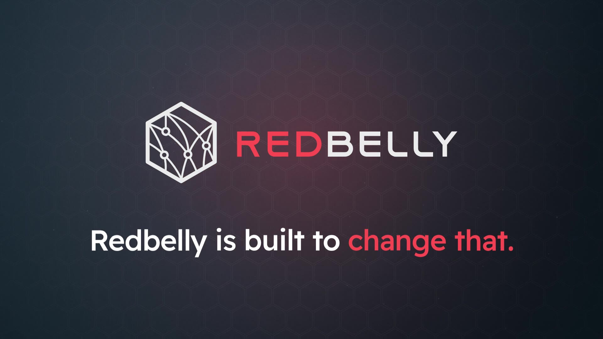
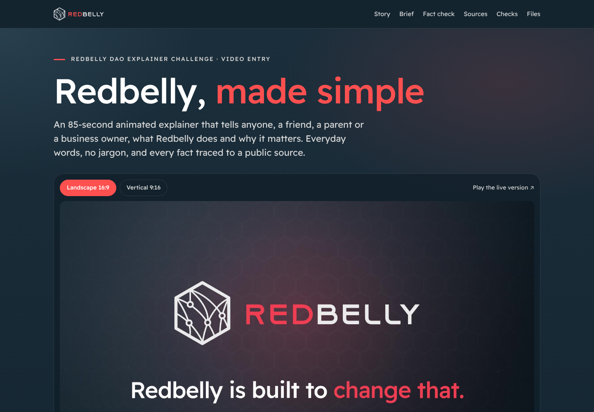
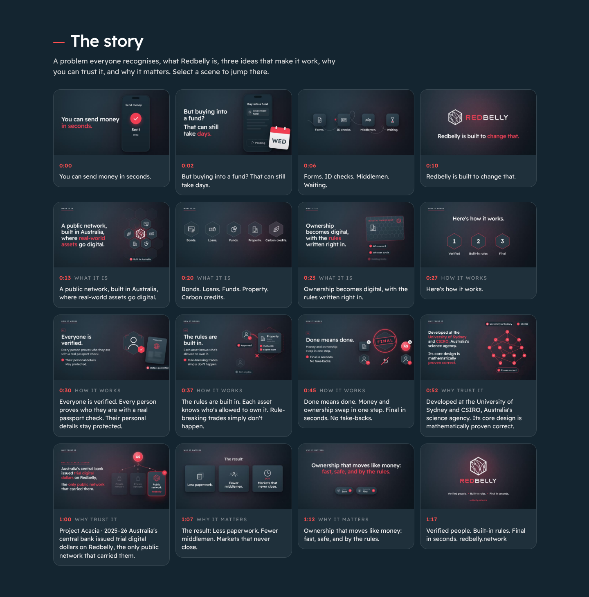
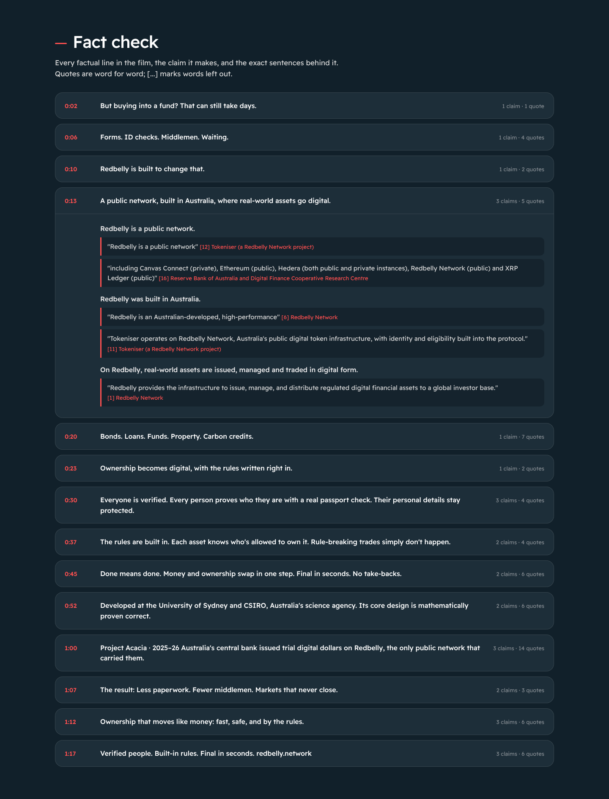
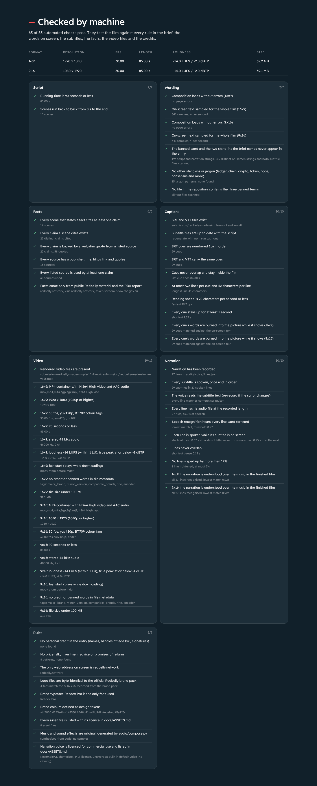
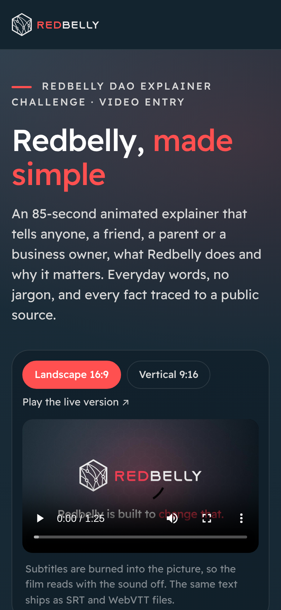

<p align="center">
  
</p>

<h1 align="center">Redbelly, made simple</h1>

<p align="center">
  An 85-second animated explainer that tells anyone, a friend, a parent or a business owner,<br>
  what Redbelly does and why it matters, in everyday words.
</p>

<p align="center">
  <a href="https://redbelly-made-simple.vercel.app"><b>Open the review site</b></a>
  &nbsp;·&nbsp;
  <a href="submission/redbelly-made-simple-16x9.mp4">Film 16:9</a>
  &nbsp;·&nbsp;
  <a href="submission/redbelly-made-simple-9x16.mp4">Film 9:16</a>
  &nbsp;·&nbsp;
  <a href="submission/SOURCES.md">Sources</a>
  &nbsp;·&nbsp;
  <a href="submission/FACT-CHECK.md">Fact check</a>
  &nbsp;·&nbsp;
  <a href="docs/VERIFICATION.md">Verification</a>
</p>

<p align="center">
  
  
  
  
  
</p>

<p align="center">
  <a href="https://redbelly-made-simple.vercel.app"></a>
</p>

## The entry

The Redbelly DAO challenge asks for Redbelly to be explained to people outside crypto, in one short video or X thread, without the word the brief bans or its stand-ins. This entry is a **video**: an animated explainer in the Redbelly brand kit, told entirely in plain words.

It opens on something everyone knows. Sending money takes seconds, but buying into a fund can still take days of forms, ID checks, middlemen and waiting. Then it shows what Redbelly is, a public network built in Australia where real-world assets go digital, and the three ideas that make it work:

1. **Everyone is verified.** Every person proves who they are with a real passport check, and their details stay protected.
2. **The rules are built in.** Each asset knows who is allowed to own it, and rule-breaking trades simply don't happen.
3. **Done means done.** Money and ownership swap in one step, final in seconds, with no take-backs.

It closes on why you can trust it (University of Sydney and CSIRO research, a core design that is mathematically proven correct, and Australia's central bank issuing trial digital dollars on Redbelly in Project Acacia) and why it matters: less paperwork, fewer middlemen, and markets that never close.

The words on screen carry the whole story, so it works with the sound off, which is how most people meet a video on X. The same words ship as subtitle files.

## Deliverables

| The brief asks for | Where it is |
|---|---|
| One video entry, up to 90 seconds, 1080p or higher, MP4 or MOV, with subtitles burned in or as a separate file | [`submission/redbelly-made-simple-16x9.mp4`](submission/redbelly-made-simple-16x9.mp4): 1920 x 1080, 85 s, subtitles burned in. The same cut in vertical, [`redbelly-made-simple-9x16.mp4`](submission/redbelly-made-simple-9x16.mp4), is ready for phones. Subtitles also ship as [`.en.srt`](submission/redbelly-made-simple.en.srt) and [`.en.vtt`](submission/redbelly-made-simple.en.vtt). |
| A short list of the sources used for any facts | [`submission/SOURCES.md`](submission/SOURCES.md), 16 public sources |

Also in [`submission/`](submission):

- [`SCRIPT.md`](submission/SCRIPT.md): every word on screen with timings, plus storyboard notes.
- [`FACT-CHECK.md`](submission/FACT-CHECK.md): each line of the film, the claim it makes, and the exact sentences from public sources that support it.
- [`redbelly-made-simple-submission-pack.pdf`](submission/redbelly-made-simple-submission-pack.pdf): cover, storyboard, sources, fact check and verification results in one PDF.
- `poster-16x9.jpg` and `poster-9x16.jpg`: cover frames.

## How the brief is met

| Rule in the brief | How this entry meets it | Checked by |
|---|---|---|
| Someone with no crypto knowledge understands Redbelly after one watch | Starts from an everyday moment, uses one idea per screen, and repeats the three ideas at the end | Script review; see [`SCRIPT.md`](submission/SCRIPT.md) |
| Original, memorable and easy to share | Original animation in the Redbelly brand system, a bookend line ("Ownership that moves like money") and a three-part tagline | |
| Every fact about Redbelly is correct | 22 claims, each backed by word-for-word quotes from Redbelly, Tokeniser and the RBA's Project Acacia report | `npm run verify`, `npm run check-sources` |
| The banned word or a stand-in appears nowhere, including captions and on-screen text | Everything visible on screen is sampled four times a second in both formats and scanned, along with the subtitles and the file metadata. The scan covers the banned word, the two stand-ins the brief names and 13 further jargon patterns. Nothing in the repository contains the banned word or the two named stand-ins either. | `npm run verify` |
| No price talk, investment advice or promises of returns | No prices, amounts, tickers, returns or calls to buy | `npm run verify` |
| No unlicensed music, images or footage | Original synthesised score and sound effects, original icons and animation, official logo files from the Redbelly brand kit, and the OFL-licensed brand font. See [`docs/ASSETS.md`](docs/ASSETS.md) | `npm run verify` (logo hashes, asset list) |
| No AI text submitted without checking | Every sentence was checked against the sources, the quotes are verbatim, and the live pages are re-read to confirm them | `npm run check-sources` |
| No personal credit inside the deliverable | No names, handles, signatures, watermarks or "made by" lines in the film, subtitles or file metadata | `npm run verify` |
| Not posted publicly before judging | The review site sends `noindex, nofollow`, disallows crawlers in `robots.txt` and is not linked from anywhere | `vercel.json`, `robots.txt` |

## Specifications

| | Landscape | Vertical |
|---|---|---|
| File | `redbelly-made-simple-16x9.mp4` | `redbelly-made-simple-9x16.mp4` |
| Resolution | 1920 x 1080 | 1080 x 1920 |
| Length | 85.0 s | 85.0 s |
| Frame rate | 30 fps | 30 fps |
| Video | H.264 High, yuv420p, BT.709, fast start | same |
| Audio | AAC 48 kHz stereo, 256 kb/s, -14 LUFS integrated, true peak below -1 dBTP | same |
| Subtitles | Burned in, plus `redbelly-made-simple.en.srt` and `.en.vtt` | same files |

Measured values for every file are in [`docs/VERIFICATION.md`](docs/VERIFICATION.md).

## Facts and sources

The film only states what public sources say. Each scene in [`content/script.json`](content/script.json) lists the claims it makes; each claim carries quotes copied word for word from the pages listed in [`content/sources.json`](content/sources.json):

- Redbelly Network: home page, Asset Tokenisation, Project Acacia, About Us, Ecosystem and the Project Acacia pilot announcement.
- The Redbelly developer portal: identity and participation, user access, eligibility, and consensus.
- Tokeniser, a Redbelly Network project: home page, Our Technology, Instant Settlement, Automated Compliance and Always-On.
- The Reserve Bank of Australia and Digital Finance CRC's *Project Acacia* final report (May 2026).

Two facts worth calling out, because they are the strongest and most specific:

- **"Every person proves who they are with a real passport check."** Redbelly's developer portal: users must "prove they possess a valid photo identity document (passport) which is verified via biometric checks", and "all network participants MUST prove they are who they say they are before gaining access".
- **"Australia's central bank issued trial digital dollars on Redbelly, the only public network that carried them."** The RBA's report lists the three platforms used for pilot wholesale central bank money: a private Hedera-based instance run by Australian Payments Plus, Canvas Connect (classed as private) and Redbelly Network (classed as public).

## Verification

```bash
npm run verify -- --write     # runs every check, refreshes docs/VERIFICATION.md and docs/verification.json
npm run check-sources         # re-reads every live source page and confirms each quote is still there
```

`tools/verify.mjs` loads the film itself, seeks through it four times a second in both formats and collects every piece of text that is visible. It then checks:

- **Wording**: the banned word, the two stand-ins the brief names, and a stricter jargon list (ledger, chain, crypto, token, node, consensus and more) appear nowhere in the on-screen text, the subtitles or the script.
- **Facts**: every factual scene cites claims, every claim has quotes, every quote belongs to a listed source.
- **Captions**: SRT and VTT match the script, cues never overlap, stay within two lines of 42 characters and 20 characters per second, and the words of every cue are visible in the picture while the cue is shown.
- **Video**: container, codecs, resolution, frame rate, length, colour tags, fast start, loudness and true peak, measured with `ffprobe` and the EBU R128 meter.
- **Rules**: no personal credit, no price talk, only `redbelly.network` on screen, logo files byte-identical to the brand pack, brand font and colours, and every asset listed with its licence.

## How it was made

```text
content/script.json ──► composition/ (HTML, SVG and canvas scenes, a pure function of time)
        │                     │
        │                     └─► tools/render.mjs: headless Chromium draws each frame at an exact time,
        │                         lossless capture, one H.264 encode with the soundtrack
        ├─► audio/compose.py: original score and effects, timed to the same cues
        ├─► tools/captions.mjs: SRT and WebVTT
        ├─► tools/docs.mjs: SOURCES, SCRIPT, FACT-CHECK, the PDF pack, posters and thumbnails
        └─► tools/verify.mjs: the checks above
```

- **Brand.** Readex Pro throughout, the brand palette (#FF5050 and #283A46 with the secondary colours), the hexagon from the isotype as the visual motif, the labels with a red rule from the brand manual, and the official logo files, untouched. See [`docs/ASSETS.md`](docs/ASSETS.md).
- **Animation.** Every element is a function of time, so the film renders identically every time and also plays live in a browser: open [`composition/`](composition/) and press space.
- **Sound.** A 96 BPM score in A minor that resolves to C major when Redbelly appears, with sound effects on the beat. It is generated from sine waves, band-limited saw waves and filtered noise; no samples or recordings are used.

## Build it yourself

Requirements: Node.js 20 or later, Python 3.10 or later, and `ffmpeg` on the PATH. `pdftotext` (poppler-utils) is only needed for `check-sources`.

```bash
npm install
npx playwright install chromium
python3 -m pip install -r audio/requirements.txt

npm run produce        # captions, soundtrack, both renders, docs, verification
npm run preview        # http://127.0.0.1:8080 for the review site and the live player
```

Each step also runs on its own: `npm run captions`, `npm run audio`, `npm run render:16x9`, `npm run render:9x16`, `npm run docs`, `npm run verify`, `npm run stills -- 12.6 33.6` (still frames for review).

## Review site and deploying

[`index.html`](index.html) is a static review site for the whole entry: the film in both formats, a clickable storyboard, every subtitle line highlighted as the film plays, the brief point by point, the fact check with its quotes, the sources, the verification results and the files.

<p align="center">
  
</p>

<p align="center">
  
</p>

<p align="center">
  
</p>

<p align="center">
  
  &nbsp;
  
</p>

- **Live:** [redbelly-made-simple.vercel.app](https://redbelly-made-simple.vercel.app)
- **Vercel:** import the repository with the *Other* framework preset. There is no build step; the repository root is the site. [`vercel.json`](vercel.json) adds `noindex` headers and correct subtitle content types.
- **Any static host:** upload the repository as it is, or run `npm run preview` locally.

The site is for the judges. It is marked `noindex, nofollow` and should not be shared publicly before the DAO announces a winner.

## Posting

Suggested caption for the DAO account (under 280 characters):

```text
What is Redbelly, minus the jargon?

A public network, built in Australia, where real-world assets go digital, with three simple ideas:
✅ Verified people
✅ Built-in rules
✅ Final in seconds

85 seconds, sound optional 👇
```

- **X:** upload the 16:9 file for the timeline, or the 9:16 file for full-screen viewing on phones. Both are under X's 512 MB and 2:20 limits. Subtitles are burned in, so the film reads with the sound off.
- **YouTube, LinkedIn and others:** upload the 16:9 file and add `redbelly-made-simple.en.srt` as a caption track for search and accessibility.

## Repository layout

```text
.
├── index.html, site/        Review site (static, no build step)
├── submission/              The deliverables: both films, subtitles, sources, script, fact check, PDF pack, posters
├── content/
│   ├── script.json          Scenes, on-screen words, subtitles, claims and sound cues
│   └── sources.json         Public sources with word-for-word quotes
├── composition/             The film as code: engine, scenes, styles, brand assets, live player
├── audio/compose.py         Original score and sound effects
├── tools/                   render, captions, docs, verify, check-sources, stills, serve
├── docs/                    ASSETS.md (licences), VERIFICATION.md and verification.json
├── vercel.json, robots.txt  Hosting headers and crawler rules
└── package.json             Scripts and the pinned Playwright version
```
